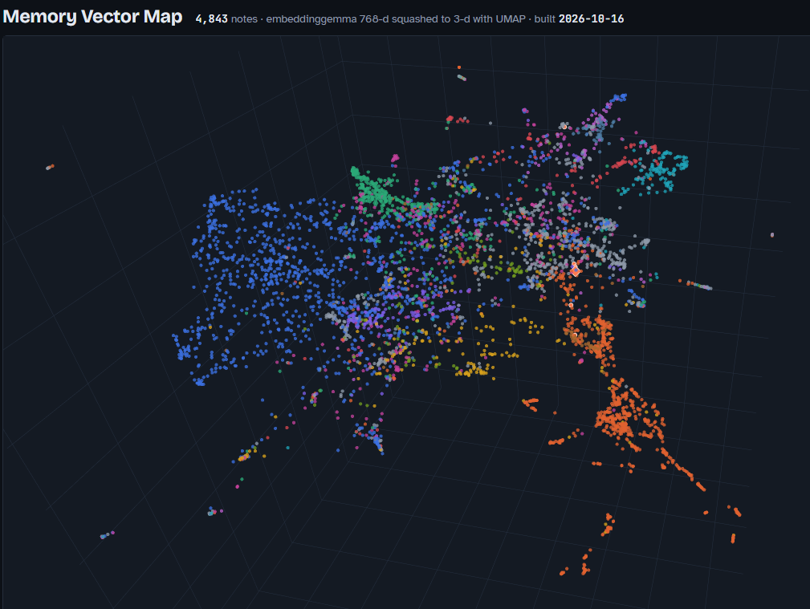
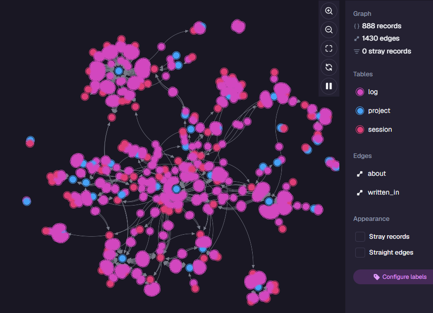

# agent-memory

<p>
  
  
</p>

**Agent memory as plain files, mirrored into [SurrealDB](https://surrealdb.com): graph links, full-text and vector search in one database, across every project.** Embeddings run locally through [Ollama](https://ollama.com), on your GPU when you have one.

[](LICENSE) [](https://www.python.org/downloads/) [](https://surrealdb.com) [](https://code.claude.com/docs/en/overview)

<sub>Left: one person's agent memory, 4,843 notes when the map was built (2026-10-16), embedded in 768 dimensions and squashed to 3 with UMAP; clusters are projects and topics (<a href="examples/vector-map/build.py">build your own</a>, optional). Right: the same memory as a graph in SurrealDB Studio, LOG lines linked to the projects they're about and the sessions that wrote them.</sub>

Your coding agent forgets everything between sessions. The usual fix is to have it keep a notes file per project, and that works until there are twenty of them. Then you can no longer answer simple questions:

- **What is waiting on whom?** Every open thread in every project, with the person or thing it waits on.
- **What did we claim but never check?** "Tests pass", "works on Windows", written down and never verified.
- **Which sessions did work and logged nothing?** Every LOG line carries its session id, so the gap shows up at the next session start.

With agent-memory, **the agent keeps its own notes and you don't write any.** They are plain markdown files you can open and read whenever you want. A small daemon mirrors them into SurrealDB, so one query answers those questions across all your projects. Built for Claude Code. The conventions work with any agent that reads files, and the hooks and skills could be adapted to agents with the same building blocks, such as Codex, which has SessionStart hooks and SKILL.md skills.

> **This repo is a guide, not an out-of-the-box product.** It's one working setup, shared as-is. But don't worry: your agent can set everything up for you, even if none of the prerequisites are installed yet (where a step needs your admin password, it hands you that one command to run). Just point it at **[Instructions for Agents](INSTALL_FOR_AGENTS.md)**.

## What a session sees

A SessionStart hook prints a brief before your first prompt: the cross-project NOW.md, this project's NOW.md, the last LOG lines, and warnings. Overdue threads go first. It is **capped at 6 KB** because Claude Code shows only 10,000 characters of hook output; anything longer becomes a 2,000-character preview, and nothing asks the agent to read the rest. A long NOW.md is clipped per item and marked `[+N chars]`, never cut silently. An excerpt of the brief for the demo's Tidepool project, as if it lived in `~/dev` (some sections left out here to keep it short):

```text
=== this session ===
Session ID: 0123456789abcdef (LOG.md tag: s:01234567)

=== ~/dev/tidepool/NOW.md ===
# Tidepool — NOW
Updated: 2026-03-14 by Claude Code · s:9a7f3b11
## State
- Tide charts render from local harmonic math (no NOAA calls at view time); staging is live, production is not.
## Decisions (incl. things decided against)
- 2026-03-10, Sam: decided against a native mobile app; the PWA covers offline charts.
## Open threads (waiting on whom)
OVERDUE - Waiting on Priya: the colour-blind-safe palette for the tide bands. (review by 2026-03-20)
OVERDUE - Waiting on Marco: whether the VPS can take production traffic, or we move to a paid host. (review by 2026-04-01)
- Claimed, not verified: the harmonic math matches NOAA within 3 cm for all 40 stations (checked 6 of them).

=== last 5 of ~/agent-notes/LOG.md ===
- 2026-03-11 · Claude Code · tidepool + garden-sensors · shared the MQTT broker config between both projects · s:e03d6c58
- 2026-03-14 · Claude Code · garden-sensors · decided against solar panels for now; started a 30-day battery test · s:7f3a91c2
```

When the repo has commits newer than its NOW.md, the brief opens with `!!! STALE`. When sessions edited files but never wrote a LOG line, it lists them by tag.

## Ask across projects

Excerpts from the demo (`agent-memory demo` prints them in full):

```text
$ agent-memory query "RETURN fn::waiting_on()"
garden-sensors · Waiting on Ines: whether the shed has a spare outlet for the gateway. (review by 2026-03-21)
tidepool · Waiting on Marco: whether the VPS can take production traffic, or we move to a paid host. (review by 2026-04-01)
tidepool · Waiting on Priya: the colour-blind-safe palette for the tide bands. (review by 2026-03-20)

$ agent-memory query "RETURN fn::unverified()"
tidepool · Claimed, not verified: the harmonic math matches NOAA within 3 cm for all 40 stations (checked 6 of them).

$ agent-memory query "RETURN fn::session('s:e03d6c58')"
- 2026-03-11 · Claude Code · tidepool + garden-sensors · shared the MQTT broker config between both projects · s:e03d6c58

$ agent-memory search "why don't we call the tide API when someone opens a chart" 3
tidepool · state · Tide charts render from local harmonic math (no NOAA calls at view time); ...  [projects/tidepool/NOW.md:6]
tidepool · frontmatter · name: no-noaa-at-view-time description: tide charts must not call the NOAA API while a user waits ...
```

The search line fuses keyword (BM25) and vector hits in one SurrealDB query. The old memory that `no-noaa-at-view-time` **supersedes** is left out of the results; archived files are too.

Also there: `fn::overdue()` (past their `review by` date), `fn::stale_nows(14)` (NOW.md files nobody touched in two weeks), `fn::conflicts()` (memories marked as contradicting each other), `fn::history('<memory>')`, `fn::entries('<project>', 'decided_against')` and `fn::logs('<project>')`. SurrealDB Studio can browse all of it as a graph.

## Speed

**Very fast, because there is no LLM anywhere in it.** Nothing summarises, extracts or rewrites your notes, at sync time or at search time. The only model is a small embedding model, embeddinggemma (308M parameters), and it needs about **690 MB of VRAM**, so it fits on almost any GPU and stays loaded. Graph-RAG tools run an LLM over every chunk to build their index, which makes ingest slow; here a changed note is embedded in tens of milliseconds (about 13 ms per block in a batch of 32).

One hybrid search, keyword and vector fused in a single SurrealDB query, on 5,190 real memory entries:

| | p50 | p95 |
|---|---|---|
| Embed the question (Ollama, RTX 3090) | 23.6 ms | 32.8 ms |
| Hybrid search in SurrealDB | 14.6 ms | 20.5 ms |
| **Both** | **38.8 ms** | **50.4 ms** |

p50 is the typical search (half were faster); p95 is the slow end (only 1 in 20 took longer).

Measured 2026-10-18: 22 questions × 5 passes (n = 110). The embedding ran on the GPU (RTX 3090, Ollama on Windows); the search itself runs on the CPU (Ryzen 7 5800X), in SurrealDB 3.3.4 under Docker, called from WSL2. A one-shot `search` command adds about 0.25 s of Python start-up. Method, setup and what this does not measure: [docs/BENCHMARKS.md](docs/BENCHMARKS.md).

## Quickstart

What it needs. **You don't have to install any of these first:** the installer checks for them and offers to install whatever is missing.

- [Claude Code](https://code.claude.com/docs/en/overview), the agent this is built for (the one thing it won't install for you)
- [uv](https://docs.astral.sh/uv/), which also installs [Python](https://www.python.org/downloads/) 3.12 if you don't have it
- [Docker](https://docs.docker.com/get-started/get-docker/), to run [SurrealDB](https://surrealdb.com) 3.3.4 (or bring your own SurrealDB)
- [Ollama](https://ollama.com), optional: without it, search is keyword only. On WSL it goes in as the Windows app.

If anything is missing, the installer shows a checklist. Type a number to untick something you'd rather install yourself, then press Enter, and it runs each vendor's own installer, showing every command first:

```text
agent-memory dependencies (WSL2):
  [ok]      uv (Python package manager)
  [ok]      Python 3.12 (installed by uv)
  [missing] Docker Engine inside WSL
  [missing] SurrealDB 3.3.4 image
  [ok]      Ollama for Windows (GPU, port 11434), for search by meaning

Install these? Type a number to toggle it, Enter to go ahead, q to quit.
  1. [x] Docker Engine inside WSL
  2. [x] SurrealDB 3.3.4 image
>
```

To see the list and the commands without changing anything: `scripts/install-deps.sh --dry-run`.

```bash
git clone https://github.com/duplonicus/agent-memory && cd agent-memory
./install.sh          # checks dependencies, then asks before every change outside the repo; --yes to accept all
agent-memory demo     # invented demo projects in their own database: the brief, the queries, a search
                      # ("command not found"? open a new terminal: the installer put it in ~/.local/bin)
```

On Windows, run `.\install.ps1` in PowerShell (its dependency step uses winget: uv, Docker Desktop, Ollama). Or point your agent at [INSTALL_FOR_AGENTS.md](INSTALL_FOR_AGENTS.md) and let it do the install with you.

The installer writes `~/.config/agent-memory/config.toml` and an `.env` with random passwords, starts SurrealDB in [Docker](https://www.docker.com) (loopback only), applies the schema, offers to download the embedding model (about 620 MB), and adds the hooks (the session-start brief and the four that keep the notes current), the `/sum` and `/search` skills and a short conventions section to `~/.claude`. Existing `settings.json` and `CLAUDE.md` are backed up, then added to. Nothing is overwritten.

## Start the agent in the project folder

```bash
cd ~/dev/tidepool && claude
```

The brief, the project's NOW.md and Claude Code's own project memory are all picked by **the folder the agent was started in**. A `cd` inside a running session changes none of them.

- **Symlinks are fine.** A path through a symlink resolves to the real folder.
- **The same folder by two real paths is two projects to Claude Code.** On WSL, `/home/you/dev/x` and `/mnt/c/Users/you/dev/x` (or `C:\Users\you\dev\x` from a Windows launch) each get their own memory folder.
- **On WSL's `/mnt/c`, case matters to Claude Code but not to the disk.** `cd /mnt/c/users/...` and `/mnt/c/Users/...` both work, and Claude Code treats them as two paths. One way that shows up: the global CLAUDE.md is loaded twice. Pick one spelling, or add the other to `claudeMdExcludes`.

## Where things run

Four pieces: the **agent** (Claude Code and its hooks), **your files**, **SurrealDB** with the **sync daemon**, and **Ollama** for embeddings. Each talks to the others over `127.0.0.1`, so they normally all live on one machine.

### Linux

Everything runs natively. SurrealDB is a Docker container on `127.0.0.1:8000`, the sync daemon is a systemd user service (`agent-memory-sync.service`), Ollama is on its default port 11434, and Claude Code runs in your shell. The defaults need no changes.

### WSL2 (Linux on Windows)

Run Claude Code, your project folders and agent-memory **inside WSL**, as on Linux. Keep the projects on the Linux disk (`~/dev`), not under `/mnt/c`: it is faster, and file paths are case-sensitive the way Claude Code expects (see the path notes above). The installer is `./install.sh`, and the sync daemon is a systemd user service, which needs systemd enabled in WSL.

- **SurrealDB:** Docker Desktop for Windows with WSL integration turned on, or Docker Engine installed inside WSL. Both serve `127.0.0.1:8000` to WSL.
- **Ollama as the Windows app, with everything else in WSL.** This is what the dependency installer sets up. WSL can only reach it at `127.0.0.1` with [mirrored networking](https://learn.microsoft.com/en-us/windows/wsl/networking#mirrored-mode-networking) (`networkingMode=mirrored` under `[wsl2]` in `%UserProfile%\.wslconfig`, Windows 11 22H2 or later). On the default NAT networking, WSL has to use the Windows host's IP address instead, and Ollama has to listen beyond `127.0.0.1` (`OLLAMA_HOST=0.0.0.0`), which opens it to your network. If Ollama answers anywhere but `127.0.0.1:11434`, set `[embed] url` in the config to that address.
- **Or Ollama inside WSL too**, which needs no networking change. **Both run at the same speed:** on an RTX 3090 the two were within noise of each other ([measured](docs/BENCHMARKS.md#ollama-on-windows-vs-inside-wsl-2026-10-18)), because CUDA in WSL forwards to the same Windows driver. NVIDIA GPUs work in WSL 2 through the normal Windows driver ([NVIDIA's guide](https://docs.nvidia.com/cuda/wsl-user-guide/index.html); don't install a Linux GPU driver inside WSL).

### Windows (native, no WSL)

Run `.\install.ps1` in PowerShell. Everything runs as Windows programs: agent-memory under Windows Python (uv installs it), SurrealDB in Docker Desktop, Ollama as the Windows app on port 11434, and the sync daemon as a Task Scheduler task that starts at logon. Claude Code runs hooks in Git Bash when it is installed and in PowerShell otherwise; the installer pins its hooks to PowerShell so they behave the same either way.

### What has been tested

| | Tested | Not yet tested |
|---|---|---|
| Linux, WSL2 | Test suite, installer, and in real Claude Code sessions the session-start brief and the Stop hook (the other three hooks are tested as processes) | The systemd service the installer writes |
| Windows (native) | Test suite (all five hooks run as processes) and installer with Windows Python; the brief through PowerShell | The Task Scheduler task; Claude Code for Windows running the hooks |
| macOS | Nothing yet | No service either: run `agent-memory daemon` yourself |

## How it works

1. **The agent writes markdown; you don't have to.** The [CLAUDE.md section](templates/CLAUDE.md) the installer adds teaches it to keep one `NOW.md` per project (current state, six sections) and one shared `LOG.md` (one line per session), next to Claude Code's own memory files and your `CLAUDE.md`. These files are the memory. You can read them any time; nothing expects you to write them.
2. **The sync daemon copies them into SurrealDB every 20 seconds, one way.** Every block (bullet, paragraph, heading) becomes a row with its exact bytes, so each file can be rebuilt byte for byte. An edited file only touches the blocks that changed; a removed block is marked superseded, not deleted.
3. **Graph edges tie it together.** Entries and LOG lines point at their project, LOG lines at the session that wrote them, memories at the memories they supersede or contradict.
4. **Ollama embeds each block** (embeddinggemma, 768 dimensions) into an HNSW index in the same database.
5. **The SessionStart hook reads the files, not the database.** A session starts with its brief even when SurrealDB is down.
6. **Four more hooks keep the notes current**, because conventions alone rely on the agent remembering, and it doesn't. A turn that ends after a commit, or after real work with no LOG line, is sent back once to write it down. A message that sounds like a decision ("let's not", "instead", "waiting on") arrives with a reminder to record it. LOG.md is append-only: a whole-file rewrite is refused. A context compaction leaves a LOG line pointing at the transcript. Each one only nudges; none can trap a session ([agent_memory/handoff.py](agent_memory/handoff.py)).

**What gets indexed, and what doesn't.** Only the memory: your `CLAUDE.md` and `rules/`, Claude Code's memory files, the shared notes folder, and in each project its `NOW.md`, its `state/` notes and its `CLAUDE.md`. **Not code, READMEs or other repo docs.** A session working in a project already reads that project's files, and grep finds code faster and more exactly than a search by meaning would. The cross-project memory is the part nothing else can answer.

A moved or renamed project folder keeps its ids, vectors and edges: a new file whose bytes match exactly one file that vanished in the same pass is treated as the same file. A sync that would retire more than 10 files at once (or more than a fifth of them, when that is more) is refused, so an unmounted drive cannot wipe the mirror.

## The conventions

The templates are the product as much as the code: [templates/NOW.md](templates/NOW.md), [templates/LOG.md](templates/LOG.md), [templates/memory.md](templates/memory.md) and the [CLAUDE.md section](templates/CLAUDE.md) that teaches the agent to use them. What the agent is taught:

- **Write it down when it happens.** A decision, especially a decision **not** to do something; an open thread and who it waits on; anything claimed but not verified.
- **NOW.md is state, LOG.md is history.** Overwrite NOW.md; append to LOG.md.
- **Every LOG line ends with `s:<first 8 characters of the session id>`.** It ties the line to the transcript that wrote it.
- **`(review by YYYY-MM-DD)`** on an open thread, or `review_by:` in a memory's frontmatter, makes it come back by itself.
- **`supersedes:` and `contradicts:`** in a memory's frontmatter link it to the memory it replaces or conflicts with.

## SurrealDB version

Pinned to **3.3.4**, the version this is tested on. One planner bug in that version: an indexed field (`kind`, `status`, `project`) and a graph condition (`->about->...`) in one `WHERE` can silently return too few rows. The `fn::` reads go through the graph edge first to avoid it, and the daemon checks for it on every full pass. Write your own queries the same way.

## Compared with other tools

See [docs/COMPARISON.md](docs/COMPARISON.md), including where the alternatives are ahead.

## License

MIT
