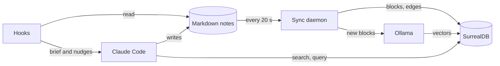

# How the pieces fit

agent-memory is a handful of small parts around one idea: **the agent's notes are plain markdown files, and everything else is built from them.** The database is a copy for asking questions across all the files at once. Delete it and the next sync rebuilds it from the files; only the history of past edits, which the database keeps, would be gone.

## What runs

| Piece | What it is | Reads | Writes | When it's down |
|---|---|---|---|---|
| **The notes** | `NOW.md` per project, `LOG.md` and a cross-project `NOW.md` in the notes folder, Claude Code's memory files, `CLAUDE.md` and `rules/` | | | n/a: they're the source of truth |
| **The agent** | Claude Code, taught the conventions by the [CLAUDE.md section](../templates/CLAUDE.md) | the notes, the brief | the notes | n/a |
| **The hooks** | five Claude Code hooks ([HOOKS.md](HOOKS.md)) | the notes, the session transcript | LOG.md (the compaction line only) | the session runs without them |
| **The sync daemon** | `agent-memory daemon`: a systemd user service, or a Task Scheduler task on Windows | the notes, every 20 s | SurrealDB | the database falls behind; it catches up on restart |
| **SurrealDB 3.3.4** | the database, in Docker on `127.0.0.1:8000` | | | search and queries stop; the brief and the notes still work |
| **Ollama** | runs embeddinggemma, on the GPU when there is one | | vectors, through the daemon | search falls back to keyword only; new notes wait for vectors |
| **The CLI** | `agent-memory search`, `query`, `status`, `sync`, `demo` | SurrealDB, the notes | SurrealDB (`sync`; `demo` uses its own database) | `status` says what's down |
| **The skills** | `/sum` (write NOW.md and the LOG line) and `/search` | the notes, the CLI | the notes | |

## The picture

## A session's life

1. **Start.** The session-start hook prints the brief: the project's NOW.md and the cross-project one (clipped to 6 KB), warnings (stale NOW.md, oversize, unlogged sessions), the last LOG lines, and this session's tag.
2. **Work.** When your message sounds like a decision, the prompt hook reminds the agent to record it. The agent writes decisions, open threads and unverified claims into NOW.md as they happen.
3. **Search.** When you mention something from the past, the agent runs `agent-memory search` (or `/search`) before answering from memory.
4. **End of each turn.** If the session committed, or did real work without a LOG line, the Stop hook sends it back once to update NOW.md and append its tagged LOG line.
5. **Compaction.** If the context gets compacted, the pre-compact hook leaves a LOG line pointing at the full transcript.
6. **Next session.** It starts from step 1, with this session's notes in its brief. If this one never logged, the brief lists it by tag.

## A note's path

1. The agent writes or edits a markdown file.
2. Within 20 s the daemon notices: it compares every file's SHA-256 with the database's, so only changed files are read again.
3. The file is split into blocks (heading, bullet, paragraph, code fence, table, frontmatter). Each block's id is a hash of its file, heading path and text, so an unchanged block keeps its id. A block that disappeared is marked `superseded`, not deleted, so the database keeps its history.
4. Each block gets a kind from where it sits: a bullet under "Decisions" is a `decision`, or `decided_against` when it says so; under "Open threads" it's an `open_thread`; a memory file's blocks take the memory's type. `(review by YYYY-MM-DD)` is picked up as a review date.
5. Graph edges are written: every block `about` its project, every LOG line `about` its project(s) and `written_in` its session. A memory's `supersedes:` and `contradicts:` frontmatter link it to the memories it names.
6. Ollama embeds the new blocks; vectors for superseded blocks are dropped.

A file that moves keeps everything: if a new file's bytes match exactly one file that vanished in the same pass, it's treated as that file. And a pass that would retire more than 10 files at once (or a fifth of them) is refused, so an unmounted drive can't empty the database.

## A search

1. `agent-memory search "question"` asks Ollama to embed the question (about 24 ms on an RTX 3090).
2. One `fn::search` call in SurrealDB runs a BM25 keyword search and an HNSW vector search, and fuses the two rankings with reciprocal rank fusion (about 15 ms).
3. Results from archived files and superseded memories are dropped, and the top hits print with project, kind, text, file and line.

If Ollama doesn't answer, the same call runs keyword-only, and the CLI says so. Numbers and method: [BENCHMARKS.md](BENCHMARKS.md).

## The data model

| Table | One row per |
|---|---|
| `source` | file: path, kind, project, SHA-256, archived flag, memory frontmatter |
| `entry` | block of a file: kind, text, exact bytes, heading path, review date, status |
| `log` | LOG.md line: date, agent, project, summary, session tag |
| `emb` | active entry's vector, under the entry's own id |
| `project` | project, by canonical name (lowercase, hyphens; aliases in the config) |
| `session` | session tag |

| Edge | From → to |
|---|---|
| `about` | entry or log line → project |
| `written_in` | log line → session |
| `supersedes` | memory file → the memory it replaces |
| `contradicts` | memory file → the memory it conflicts with |

The cross-project reads (`fn::waiting_on`, `fn::unverified`, `fn::overdue`, `fn::stale_nows`, `fn::session`, `fn::entries`, `fn::logs`, `fn::history`, `fn::conflicts`) are in [functions.surql](../agent_memory/functions.surql).

## Decisions behind it

- **Files are the source of truth; the database is a one-way copy.** Notes stay readable and editable without any tool, survive the database, and work for agents that only read files.
- **No LLM anywhere.** Nothing summarises or rewrites the notes, so nothing drifts from what was written, and ingest costs only one small embedding per block.
- **Only memory is indexed, not code or repo docs.** A session working in a project already reads its files, and grep finds code faster and more exactly than search by meaning.
- **The hooks read files, not the database,** so a session starts with its brief even when SurrealDB is down.
- **SurrealDB is pinned to 3.3.4.** In that version, an indexed field (`kind`, `status`, `project`) and a graph condition (`->about->...`) in one `WHERE` can silently return too few rows. The `fn::` reads go through the graph edge first, and the daemon checks for the bug on every full pass.
